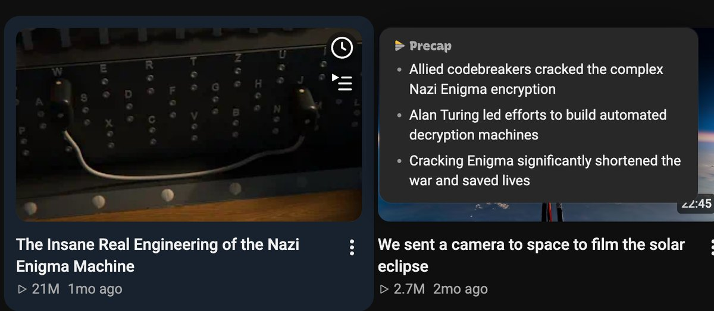

<picture><source media="(prefers-color-scheme: dark)" srcset="assets/logo-lockup-dark.png"></picture>

<h1 align="center">Precap</h1>

Hover any video. Get the point before you press play.

## Install

Install **[Precap for YouTube from the Chrome Web Store](https://chromewebstore.google.com/detail/precap-for-youtube/jfakiibncpjgkdfogdcpablpdmfildcb)**. This is the recommended way, and it updates on its own.

Then open (or reload) YouTube while signed in, go to Home or Subscriptions, and rest the mouse on a video for about a second.

### Local install (for debugging)

Only for debugging or trying local changes:

1. Open `chrome://extensions` and turn on **Developer mode** (top right).
2. Click **Load unpacked** and pick the `extension/` folder of this repo. It appears as **Precap for YouTube**.

To update, `git pull` and press the reload icon on the Precap for YouTube card.

## How it works

Rest the pointer on a video on Home or Subscriptions for about a second, or Tab to it, and a small card beside it gives the video's point in two or three bullets. Move away, scroll or press Esc to close it. Shorts, ads, playlists and live streams are skipped.

Each summary is a question to YouTube's own Ask feature (Gemini), asked as you with your signed-in YouTube session. There's no API key, and nothing is sent anywhere but YouTube. Ask is only offered to some accounts and videos; when it isn't, the card says so.
