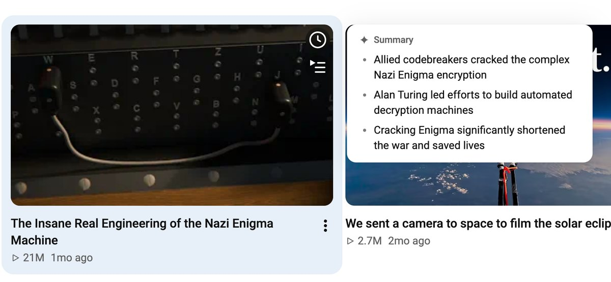
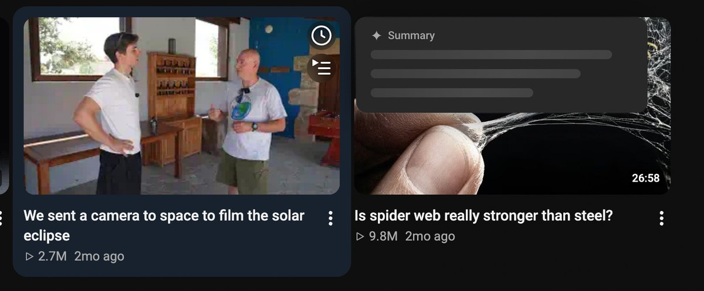
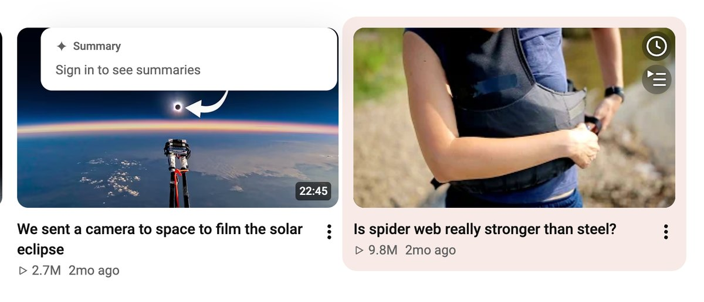
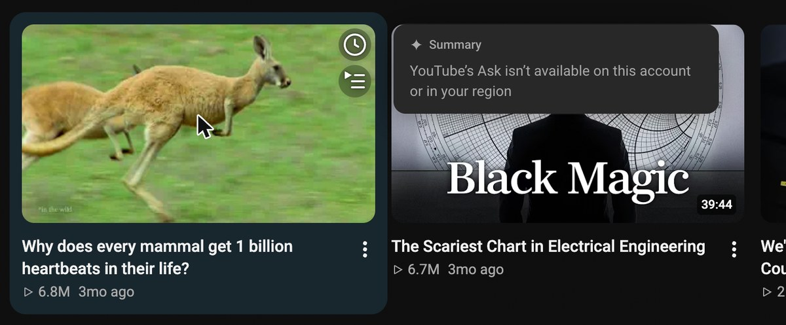
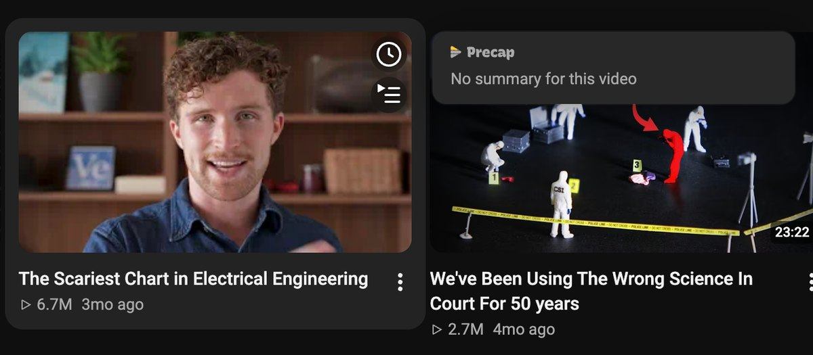
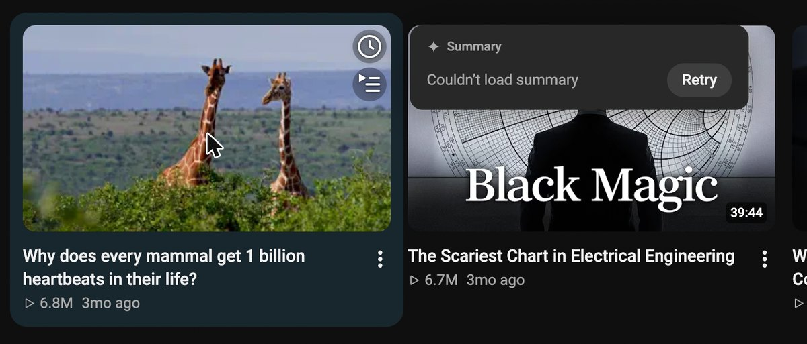

<!-- Logo goes here: 

 -->

<h1 align="center">YT TL;DW</h1>

Hover a video on YouTube for a second and see what it's about, in two or three bullets. 
No API keys: it asks YouTube's own built-in Ask (Gemini) feature.

## Install

1. Open `chrome://extensions` and turn on **Developer mode** (top right).
2. Click **Load unpacked** and pick the `extension/` folder of this repo.
3. Open (or reload) YouTube while signed in, go to Home or Subscriptions, and rest the mouse on a video for about a second.

To update, `git pull` and press the reload icon on the extension's card.

## How it works

YouTube's watch page has an **Ask** button that opens a Gemini chat about the video. This extension calls the same private InnerTube endpoints the page uses, from inside the page, with your existing YouTube session:

1. `POST /youtubei/v1/next` with the `videoId`. The response carries the Ask panel (`PAyouchat`), including the continuation token for its free-text question box.
2. `POST /youtubei/v1/get_panel` with that continuation and a short custom prompt (2 or 3 bullets, at most 10 words each, main takeaway first). The answer comes back as one JSON response; the markdown text is trimmed into bullets.

The request carries the same headers YouTube's own code sends (`Authorization: SAPISIDHASH ...` computed from your cookies at request time, `X-Goog-AuthUser`, `X-Youtube-Client-Name/Version`, `X-Goog-Visitor-Id`). Nothing is sent anywhere except `www.youtube.com`, and the extension asks for no permissions beyond running on that site.

Two scripts make this work:

- `src/main-world.js` runs in the page's own JS world (it needs `ytcfg` and the page session) and only does the two InnerTube calls.
- `src/content.js` + `src/popover.css` run in the extension's isolated world: hover tracking, the popover, caching. The two talk over `window.postMessage`; everything shown is rendered as text, never HTML.

Behaviour details:

- Only active on `/` and `/feed/subscriptions` (change `ACTIVE_PATHS` in `content.js` to add pages).
- The popover appears once the pointer has rested on a card for ~1 s (sweeping across the grid, or the page scrolling under a still pointer, doesn't count), beside the card (right, else left; above or below in one-column layouts) so the thumbnail and its preview stay visible. Its loading placeholder has the shape of a typical answer, so it doesn't jump when the text arrives. Moving into it keeps it open; leaving closes it after a short grace; scrolling with the wheel or pressing Esc closes it.
- Tabbing to a card with the keyboard opens it the same way, and Esc closes it. Results are also announced to screen readers. Motion is a short fade and scale, reduced to a plain fade with `prefers-reduced-motion`.
- Shorts, ads, playlists/mixes, live and upcoming streams are skipped silently.
- Results are cached per video in memory until the page reloads, at most 2 requests run at once, at most 10 Ask questions are sent per minute, and a request is cancelled when you move away (unless the answer is about to arrive, then it's kept for the cache). Timeout is 15 s.

## What you'll see when it can't summarize

| Situation | Message |
| --- | --- |
| Signed out | Sign in to see summaries (no request is sent) |
| Ask not offered to this account, country or language | Ask isn't available for your account or region (remembered for the session) |
| Ask not offered for this video (kids content, live streams, ...) | No summary for this video |
| Network/HTTP error, timeout, rate limit (YouTube's or the extension's 10 per minute), odd response | Couldn't load summary, with one **Retry** (then: Try again later) |

"Not available for the account" is told apart from "not available for this video" by checking one known Ask-enabled video once per session.

## Privacy and limits

- **It asks as you.** Each summary is a real Ask question sent with your signed-in YouTube session. YouTube may keep these in your YouTube/Google activity like any Ask conversation, and Ask has its own usage limits. The extension caps itself at 10 questions a minute.
- **No other servers.** Requests go only to `www.youtube.com`. There is no analytics, no third-party server, no remote code, and no extension permissions beyond running on `www.youtube.com`. Auth headers are computed per request and never logged or stored.
- **Nothing persisted.** Summaries are cached in memory for the open page only; nothing is written to storage.
- **Private API.** `next`/`get_panel` and the Ask panel's shape are undocumented and can change any day; when they do, you'll see "Couldn't load summary" until the parsing is updated.
- **Availability.** Ask is only offered to some signed-in accounts (age, country and language restrictions apply) and not for every video.
- **Speed.** Expect roughly 3 seconds per new video (one `next` call plus the Gemini answer). Cached videos show instantly.
- The prompt is in English, so answers are in English.

## Debugging

There are no page-settable switches. For local testing, edit the constants at the top of `src/main-world.js` and reload the extension:

- `DEBUG = true` logs each request's video id and result status to the console.
- `FORCE_STATUS = "error"` (or `logged_out`, `unavailable`, `no_ask`) previews a guard state without sending any request.

To try other pages, edit `isActivePage()` in `src/content.js`.
